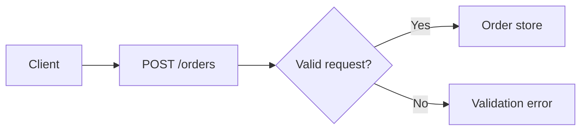
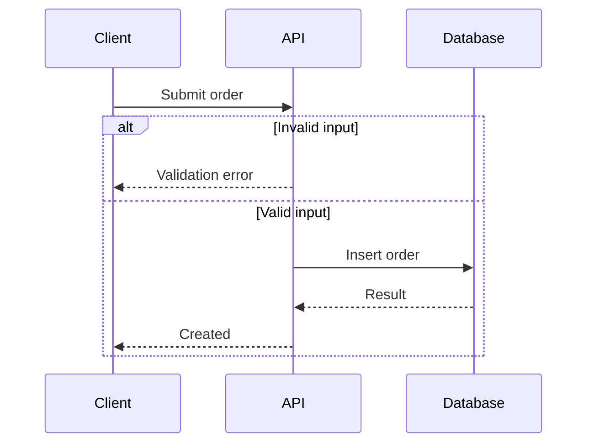
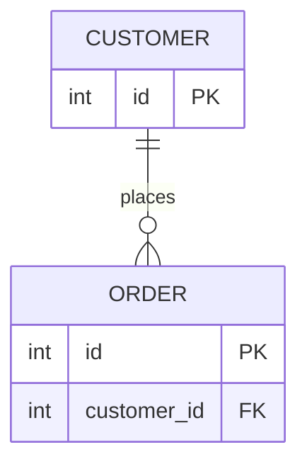

# Diagram selection and evidence

## Contents

- [Choose relevant views](#choose-relevant-views)
- [Portable examples](#portable-examples)
- [Validation and compatibility](#validation-and-compatibility)

## Choose relevant views

| View | Evidence to inspect | Show; do not invent |
|---|---|---|
| System architecture | Entry points, imports/calls, service clients, configuration | Major components and evidenced communication protocols. A declared cloud resource is configured infrastructure, not proof it is deployed. |
| User flow | Routes/screens, event handlers, role checks, state transitions | Relevant journeys, success/error/empty states and decisions. Separate roles only when behavior differs; do not infer UI from a backend route. |
| Data flow | Validation, transformations, persistence, outbound clients | Actual data movement and trust boundaries. Do not add a mandatory service/repository layer. |
| Database/ER | Schema, ORM mappings, migration history, constraints | Entities, keys and supported cardinality. Distinguish modeled, migrated, and observed schemas; an ORM relationship need not enforce a database FK. |
| Backend request/API | Route registration, middleware, handlers, downstream calls | Request validation, authorization, response/errors and side effects. Confirm middleware order and supported protocol. |
| Authentication/authorization | Login/session/token paths, refresh/logout, guards, ownership | Actual credential/session lifecycle and permission enforcement. A frontend visibility check does not prove server authorization. Never include real tokens. |
| Sequence | Call paths, awaits, transactions, callbacks, failure handling | Supported ordering, alternative outcomes and concurrent work. Source order does not prove completion order for unawaited work. |
| Deployment/infrastructure | IaC, container/build files, service config, CI | Configured hosting, networking, stores, deployment steps and external dependencies. Mark runtime topology, applied revisions, secrets and cloud state unverified unless observed through authorized evidence. |
| Background jobs/async | Enqueue sites, workers, schedules, consumers, retry config | Producer/consumer paths, failures, retries and transaction boundaries when implemented. Do not promise exactly-once delivery from a queue alone. |
| Module/feature dependencies | Imports, package boundaries, registrations, API clients | Relevant dependency direction and runtime connections. Distinguish build-time imports from network calls. |

For each important arrow, keep a source path/symbol or configuration reference
near the diagram. Explain what the evidence cannot establish rather than filling
gaps with common architecture. Unknowns can be prose instead of speculative nodes.

## Portable examples

These are **illustrations**, not assertions about the reviewed project. Replace
them only with verified entities and behavior. Basic syntax is intended for
Mermaid 10–12; verify the actual destination renderer and avoid assuming that all
minor versions and Markdown hosts behave identically.

### Flowchart with safe identifiers

Use IDs such as `request_end` rather than reserved words such as unquoted `end`.
Quote labels containing punctuation, brackets, route parameters or special words;
where quotes themselves occur, use supported entity escaping or simplify labels.
Do not put untrusted raw input into Mermaid directives, clickable links, or HTML.

### Sequence with an evidenced alternative

An arrow's direction/style does not itself establish network guarantees or
transaction semantics. Add retries, rollback, parallel blocks or failure branches
only when supported by the implementation.

### ER relationship

This example assumes an order has exactly one customer and a customer can have
zero or more orders. Do not copy this cardinality for a nullable customer field,
many-to-many association, or application-only reference without schema evidence.

## Validation and compatibility

- A local parser, such as Mermaid's `parse`, checks recognized syntax. It cannot
  establish source accuracy, layout quality, or support in another host.
- A render check must actually generate/display the diagram. Inspect it for
  clipping, readability and misleading grouping; record uninspected renders.
- GitHub documents an `info` diagram to inspect its Mermaid version. Use that only
  in an authorized preview context; offline work can instead state the unknown
  destination version and use conservative syntax.
- Avoid assuming architecture/C4/experimental syntax is supported everywhere.
  Architecture diagrams require Mermaid 11.1.0+; even supported syntax can have
  destination-specific configuration or layout differences.
- Use available project tooling. No external editor upload, runtime download,
  new dependency, or online validation is necessary merely to apply this guide.

## Sources

Original summaries checked **2026-10-27**. Mermaid usage documentation currently
describes 12.2.0; examples intentionally use older established diagram forms.

- [Mermaid syntax](https://mermaid.js.org/intro/syntax-reference.html).
- [Mermaid parsing API](https://mermaid.js.org/config/usage.html).
- [Architecture syntax/version](https://mermaid.js.org/syntax/architecture.html).
- [GitHub Mermaid support](https://docs.github.com/en/get-started/writing-on-github/working-with-advanced-formatting/creating-diagrams).
